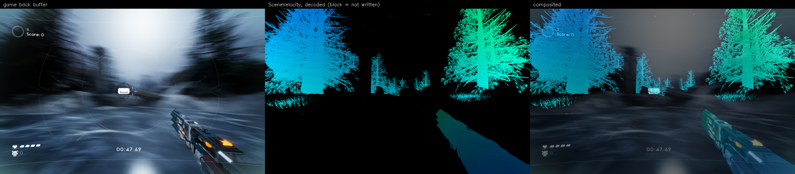

# UnrealHook

A DLL injected into a running Unreal Engine 5 game (D3D12, Shipping build) that
finds the engine's scene textures without resource names and captures them
every frame: `SceneVelocity` (motion vectors), scene depth, the back buffer, and
optionally GBufferA (normals) and GBufferB (specular). Python tools decode the
captures and check the motion field against the images.

Tested on Skyrunner (UE 5.2) and Oxi (UE 5.7).

## Build

```
cmake -B temp/build -S .
cmake --build temp/build --config Release --target mv_hook mv_injector mv_testhost
```

Everything generated goes under the gitignored `temp/`: `build/`, `logs/`
(`mv_hook.log`), `dumps/` and `out/`. The layout is in `tools/paths.py`.

## Capture

```powershell
.\Invoke-MvCapture.ps1 .\testgames\skyrunner\Valfreyja.exe
.\Invoke-MvCapture.ps1 <game.exe> -EngineVersion 5.7 -Surfaces normals,specular
```

The script launches the game, waits for its `*-Win64-Shipping` render process,
and injects the hook. It sets the environment the hook reads at startup (below),
so the game must be launched through it. `-AttachOnly` injects into a running
process, without that environment. `testgames/` is gitignored; put local copies
of games there.

In game, **F8** captures a 2400-frame burst (~20 s) into a fresh
`temp\dumps\<game>_<stamp>\`. Wait for `capture: write queue drained` in
`temp\logs\mv_hook.log` before quitting.

A dump holds one file per surface per frame (`vel_00042.bin`, `depth_`,
`color_`, `normals_`, `specular_`), `frames.csv` (capture index to game frame)
and `manifest.json` (layouts, formats, why the burst ended, dropped-frame
counts). The manifest is written when the burst has drained; tools refuse a dump
without one.

### Environment

| Variable | Effect |
|---|---|
| `MV_ENGINE_VERSION` | `5.2`, `5.7`, ... Selects the profile `ue<major>.<minor>-generic` and is recorded in the manifest; the velocity decode depends on it. |
| `MV_PROFILE` | Use this profile instead. `MV_PROFILE_FILE=<path>` adds profiles from a file. |
| `MV_SURFACES` | `normals`, `specular` or `normals,specular`: also identify and capture these. |
| `MV_DUMP_DIR` | Dump directory (default `temp\dumps\mv_dump\`). |
| `MV_AUTOCAPTURE` | Start a burst one second after injection, without F8. |
| `MV_CAPTURE_DEPTH=0` | Do not capture depth. |
| `MV_OVERLAY` | Start the overlay in this mode (see below). |
| `MV_IDENTIFY_FRAMES` | Override velocity's settling window, in frames. |
| `MV_DIAG` | Log which surfaces share a `ResourceBarrier` call and write `mv_candidates.log`. |
| `MV_SNAPSHOT` | `<surface>`: copy one frame of each of that surface's candidates to `snapshot_*.bin`. |

The script's parameters map onto these (`-EngineVersion`, `-SurfaceProfile`,
`-Surfaces`, `-DumpDir`, `-AutoCapture`, `-NoCaptureDepth`).

### Overlay

**F7** cycles: off, `SceneVelocity` as the engine's visualizer shows it,
`SceneVelocity` over the frame, and a 2x2 grid of frame, depth, normals and
specular. A quadrant whose surface was not refreshed that frame gets a red
border.

## How identification works

What to look for is data in [`profiles/ue5.json`](profiles/ue5.json), embedded
in the DLL at build time. Each surface has:

- a **structural gate**: the formats the engine can create it with, required and
  forbidden resource flags, and its size (velocity within 2x the back buffer;
  every other surface at velocity's exact size);
- **behaviour**, measured over a settling window and scored: the barrier edge
  that finishes it (`RENDER_TARGET` to shader-readable, or `DEPTH_WRITE` to
  readable for depth), how often it takes that edge, whether it is written by
  compute, and for the GBuffers whether it becomes readable in the same
  `ResourceBarrier` call as scene depth.

The top survivor must win by a margin, or identification refuses to pick
(`AMBIGUOUS` in the log). UE keeps several allocations of each scene texture
and switches between them; a surface follows a new one by **rival adoption**
when it takes the edge on 8 consecutive frames while the selected one is idle.
A profile describes what to search for, and cannot name a resource. An invalid
profile disables identification and says why in the log.

Each surface is copied at its trigger edge, the one point where the transient
resource is complete and not yet reused. The copy goes on the game's own command
list into a 4-slot readback ring, so the game never waits on the GPU. Disk
writes happen on a background thread; under backpressure whole frames are
dropped and counted.

The velocity encode is `sign(V) * sqrt(abs(V))` (`VELOCITY_ENCODE_GAMMA` in
`Common.ush`), so a linear decode is wrong everywhere. Channels 2 and 3 hold the
two halves of one float32 (the DeviceZ delta), and 5.7 uses one bit of channel 3
for `bHasPixelAnimation`. `tools/mvtools.py` decodes all of this.

## Tools

Run from `tools/`; each takes a dump directory.

| Tool | |
|---|---|
| `run_validation.py <dump> <title>` | Every check below; writes `results/validation_<title>.txt`. |
| `warp_validate.py` | Warps frame N-1 by the decoded field and scores it against frame N, against three controls. |
| `check_decode.py`, `derive_scale.py`, `region_match.py` | Decoded motion against block-matched image motion. |
| `make_video.py` | Video of the motion field beside the gameplay. |
| `gbuffer_sheet.py` | Contact sheet of colour, normals and specular (`--snapshots` for `MV_SNAPSHOT` files). |
| `inspect_velocity.py` | Sanity check of a velocity capture. |
| `barrier_signature.py` | Barrier patterns of every resource (needs a 2000-frame session). |
| `compare_dumps.py <a> <b>` | Byte-compares two dumps frame by frame. |

## Testing

`mv_testhost` runs the hook under the D3D12 debug layer and GPU-based validation
(needs the Windows **Graphics Tools** feature), against placed render targets
built to look like a UE5 frame: the real `SceneVelocity`, depth and GBuffers
among decoys that each fail one filter. It checks the selected resources by
pointer, the dump contents, and zero debug-layer errors.

```powershell
.\tools\run_testhost_suite.ps1                     # every mode
.\tools\run_testhost_suite.ps1 -Overlay            # plus the overlay under GPU-based validation
.\tools\run_testhost_suite.ps1 -Baseline <old mv_hook.dll>   # plus a byte comparison against that build
```

## Results



Left: the game's back buffer. Middle: `SceneVelocity` as the engine wrote it
(dynamic and WPO objects only). Right: the two composited.

| Test | Result | Source |
|---|---|---|
| Identification on Skyrunner | 1 of 755 profiled resources, confirmed against RenderDoc | `results/validation_skyrunner*.txt` |
| Warp-and-difference, 120 frames | 102/103 pairs improved, mean error -37.7%, beats the best rigid shift by 59.9% | `results/validation_skyrunner.txt` |
| Warp-and-difference, 60 frames | 47/47 pairs improved, mean error -53.6% | `results/validation_skyrunner_video.txt` |
| Decode vs block-matched motion | correlation X 0.99, Y 0.94; 4-6 px RMS better than a linear decode | `results/decode_scatter_skyrunner*.png` |

## Known limits

- Normals and specular are verified on Skyrunner only, and their encodings are
  not: the manifest says `"encoding": {"kind": "unknown"}` and
  `mvtools.decode_normals` refuses.
- Rival adoption stops after 64 adoptions per surface per session. On Skyrunner
  normals adopts about 8 every 2-3 minutes, so long sessions run out.
- Rival adoption follows one rival at a time: a look-alike taking the same edge
  every frame blocks it.
- With all five surfaces (~44 MB per frame) most of a burst is dropped to write
  backpressure; about a quarter to a half of the frames reach disk.
- Fence coverage is verified for the velocity copy only.
