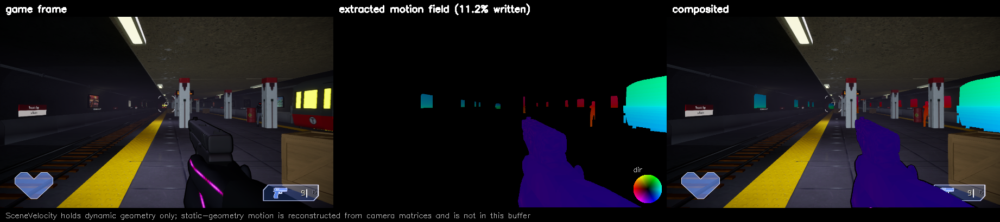

# UnrealHook

A DLL injected into a running Unreal Engine 5 game (D3D12, Shipping build) that
finds the engine's scene textures without resource names and captures them
every frame: `SceneVelocity` (motion vectors), scene depth, the back buffer, and
optionally GBufferA (normals) and GBufferB (specular). Python tools decode the
captures and check the motion field against the images.

The hook has been tested on titles built with UE 5.2, 5.3 and 5.7.

## Build

```
cmake -B temp/build -S .
cmake --build temp/build --config Release --target mv_hook mv_injector mv_testhost
```

Everything generated goes under the gitignored `temp/`: `build/`, `logs/`
(`mv_hook.log`), `dumps/` and `out/`. The layout is in `tools/paths.py`.

## Capture

```powershell
.\Invoke-MvCapture.ps1 .\testgames\<title>\<launcher>.exe
.\Invoke-MvCapture.ps1 <game.exe> -EngineVersion 5.7 -Surfaces normals,specular
```

The script launches the game, waits for its `*-Win64-Shipping` render process,
and injects the hook. It sets the environment the hook reads at startup
(below), so launch the game through the script. If the game is under
`steamapps\common`, the script also sets `SteamAppId`, which stops the game
restarting itself through Steam without that environment. `-AttachOnly`
injects into a running process, without that environment. `testgames/` is
gitignored, and local copies of games go there.

In game, **F8** captures a 2400-frame burst (about 20 seconds) into a fresh
`temp\dumps\<game>_<stamp>\`. Wait for `capture: write queue drained` in
`temp\logs\mv_hook.log` before quitting.

Each surface is identified once, about 90 frames after injection. If a title
allocates new scene targets when play starts, the search may already have
measured its menu. **F6** restarts every search from an empty shortlist, so
press it once the scene is rendering.

A dump holds one file per surface per frame (`vel_00042.bin`, `depth_`,
`color_`, `normals_`, `specular_`), `frames.csv` (capture index to game frame)
and `manifest.json` (layouts, formats, why the burst ended, dropped-frame
counts). The hook writes the manifest after the burst drains, and the tools
refuse a dump without one.

### Environment

| Variable | Effect |
|---|---|
| `MV_ENGINE_VERSION` | `5.2`, `5.3`, `5.7` etc. Selects the profile `ue<major>.<minor>-generic` and is recorded in the manifest. The velocity decode depends on it. |
| `MV_PROFILE` | Selects a profile by name, ahead of `MV_ENGINE_VERSION`. |
| `MV_PROFILE_FILE` | Names a file of loaded profiles, added to the embedded ones. |
| `MV_SURFACES` | `normals`, `specular` or `normals,specular`. Also identifies and captures those surfaces. |
| `MV_DUMP_DIR` | Sets the dump directory. The default is `temp\dumps\mv_dump\`. |
| `MV_AUTOCAPTURE` | Starts a burst one second after injection, without F8. |
| `MV_CAPTURE_DEPTH=0` | Turns off the depth capture. |
| `MV_OVERLAY` | Starts the overlay in the given mode (see below). |
| `MV_IDENTIFY_FRAMES` | Overrides velocity's `settle_frames`. |
| `MV_DIAG` | Logs which surfaces share a `ResourceBarrier` call and writes `mv_candidates.log`. |
| `MV_SNAPSHOT` | Takes a surface name, and copies one frame of each resource on that surface's shortlist to `snapshot_*.bin`. |

The script's parameters map onto these variables (`-EngineVersion`,
`-SurfaceProfile`, `-Surfaces`, `-DumpDir`, `-AutoCapture`, `-NoCaptureDepth`).
The header of [`profiles/ue5.json`](profiles/ue5.json) describes how the hook
chooses a profile and how a loaded profile overrides an embedded one.

### Overlay

**F7** cycles through four modes: off, `SceneVelocity` as the engine's
visualizer shows it, `SceneVelocity` over the frame, and a 2x2 grid of frame,
depth, normals and specular. If a quadrant's surface was not refreshed that
frame, the quadrant gets a red border. Without normals and specular, the grid
is one row of frame and depth.

A status panel at the top left, drawn in every mode, lists the hotkeys, the
view, each surface's search state and the capture state. F8 copies the frame
before the panel is drawn, so captures do not contain it.

## How identification works

[`profiles/ue5.json`](profiles/ue5.json) defines what the hook searches for on
each surface. CMake embeds it in the DLL at configure time. A profile matches
resources by descriptor and barrier behaviour only, never by name or pointer.
If a profile is invalid, the hook logs the reason and disables identification.

Identification runs each surface through three stages. The structural gate and
the behaviour gate are pass/fail filters, and a resource that fails either is
out. Scoring only ranks the survivors.

- The **structural gate** tests the descriptor of each resource the game
  passes to `ResourceBarrier`, the first time the hook sees it: its format,
  its required and forbidden D3D12 resource flags, and its size. Velocity must
  be at most twice the back buffer's width and height, and the other surfaces
  must match velocity's extent. Resources that pass join the **shortlist**.
- The **behaviour gate** watches the shortlist over a settling window. A
  resource must take its trigger edge on at least half the frames it was seen
  on. The trigger edge is `RENDER_TARGET` to shader-readable, or
  `DEPTH_WRITE` to readable for depth. Resources that pass are **survivors**.
- **Scoring** adds the format's score and weighted signals, such as whether a
  survivor is written by compute or becomes readable in the same
  `ResourceBarrier` call as scene depth. The top survivor must beat the
  runner-up by the profile's `ambiguity` margin to be selected. If it does
  not, the hook logs `AMBIGUOUS` and selects nothing.

UE keeps several allocations of each scene texture and switches between them.
If a surface's selected resource goes idle and another resource takes the
trigger edge on several consecutive frames, the surface adopts that rival. The
profile's `rival` block sets the counts.

The hook copies each surface at its trigger edge, the one point where the
transient resource is complete and not yet reused. It records the copy on the
game's own command list into a 4-slot readback ring, so the game never waits on
the GPU. A background thread writes the frames to disk. Under backpressure, the
hook drops whole frames and counts them in the manifest.

UE encodes velocity as `sign(V) * sqrt(abs(V))` (`VELOCITY_ENCODE_GAMMA` in
`Common.ush`), so a linear decode is wrong everywhere. Channels 2 and 3 hold
the two halves of one float32, the DeviceZ delta. UE 5.7.1 uses the low one or
two bits of channel 3 for `bHasPixelAnimation` and temporal responsiveness.
`tools/mvtools.py` decodes all of this and cites the engine source.

## Tools

Run the tools from `tools/`. Each takes a dump directory.

| Tool | Purpose |
|---|---|
| `run_validation.py <dump> <tag>` | Runs every check below and writes the report and figures to `results/<tag>/`. Git tracks only the `ue5.<minor>` tags. |
| `warp_validate.py` | Warps frame N-1 by the decoded field and scores it against frame N and three controls. |
| `check_decode.py`, `derive_scale.py`, `region_match.py` | Compare decoded motion against block-matched image motion. |
| `make_video.py` | Renders a video of the motion field beside the gameplay. |
| `gbuffer_sheet.py` | Builds a contact sheet of colour, normals and specular (`--snapshots` for `MV_SNAPSHOT` files). |
| `inspect_velocity.py` | Sanity-checks a velocity capture. |
| `barrier_signature.py` | Prints the barrier patterns of every resource. It needs a 2000-frame session. |
| `compare_dumps.py <a> <b>` | Byte-compares two dumps frame by frame. |

## Testing

`mv_testhost` runs the hook under the D3D12 debug layer and GPU-based
validation, which needs the Windows **Graphics Tools** feature. It builds
placed render targets laid out like a UE5 frame: stand-ins for
`SceneVelocity`, depth and the GBuffers, among decoys that each fail one test.
It checks the selected resources by pointer, the dump contents, and that the
debug layer reported no errors.

```powershell
.\tools\run_testhost_suite.ps1                     # every mode
.\tools\run_testhost_suite.ps1 -Overlay            # plus the overlay under GPU-based validation
.\tools\run_testhost_suite.ps1 -Baseline <old mv_hook.dll>   # plus a byte comparison against that build
```

## Results



Left: the game's back buffer. Middle: `SceneVelocity` as the engine wrote it,
which covers dynamic and WPO objects only. Right: the two composited.

`results/ue5.2/` and `results/ue5.7/` each hold one reference run on a title
built with that engine version: the `run_validation.py` report, its figures,
and a still and a video of the motion field.

Identification never sees resource names, so a RenderDoc capture serves as the
reference: it shows which resource holds `SceneVelocity`. On the UE 5.2 title,
identification selected the resource that the RenderDoc capture showed.

On both runs, warping each frame by the decoded field reduced the mean error
against the next frame and beat the best rigid shift. On the UE 5.2 run, the
decoded motion also matched block-matched image motion, and a linear decode
did not. The UE 5.7 run has too little motion for that regression, and its
report says so.

## Known limits

- Normals and specular are verified on two tested titles. Their encodings are
  unverified, so the manifest says `"encoding": {"kind": "unknown"}` and
  `mvtools.decode_normals` refuses.
- Rival adoption stops after `max_adoptions` adoptions per surface per
  session. Testing shows that normals adopts often enough that a long session
  reaches that cap.
- Rival adoption follows one rival at a time. If a look-alike takes the same
  edge every frame, it blocks adoption.
- With all five surfaces enabled, write backpressure drops most of a burst.
- Fence coverage is verified for the velocity copy only.
- The overlay and the back-buffer copy go to the presenting queue, which
  submits the back buffer's transition to `PRESENT`. With NVIDIA's Streamline
  plugin loaded, the presenting queue can differ from the first direct queue
  to submit. The overlay works through Streamline's swapchain wrapper on a
  tested title. An F8 burst through the wrapper is untested.
  `-GameArgs '-slnoswapchainprovider'` removes the wrapper, and frame
  generation with it.
